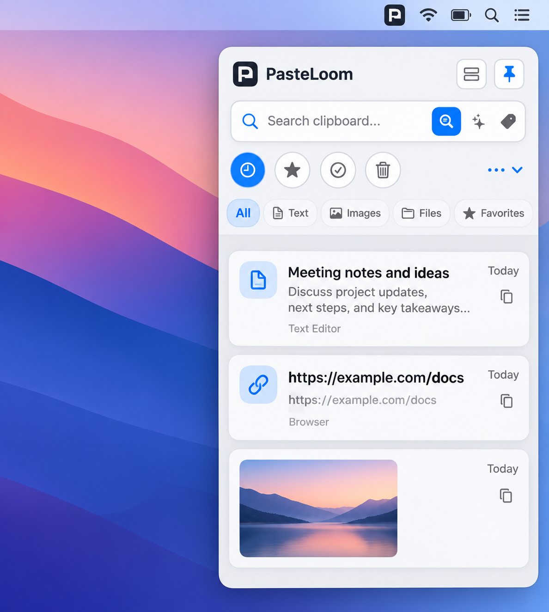
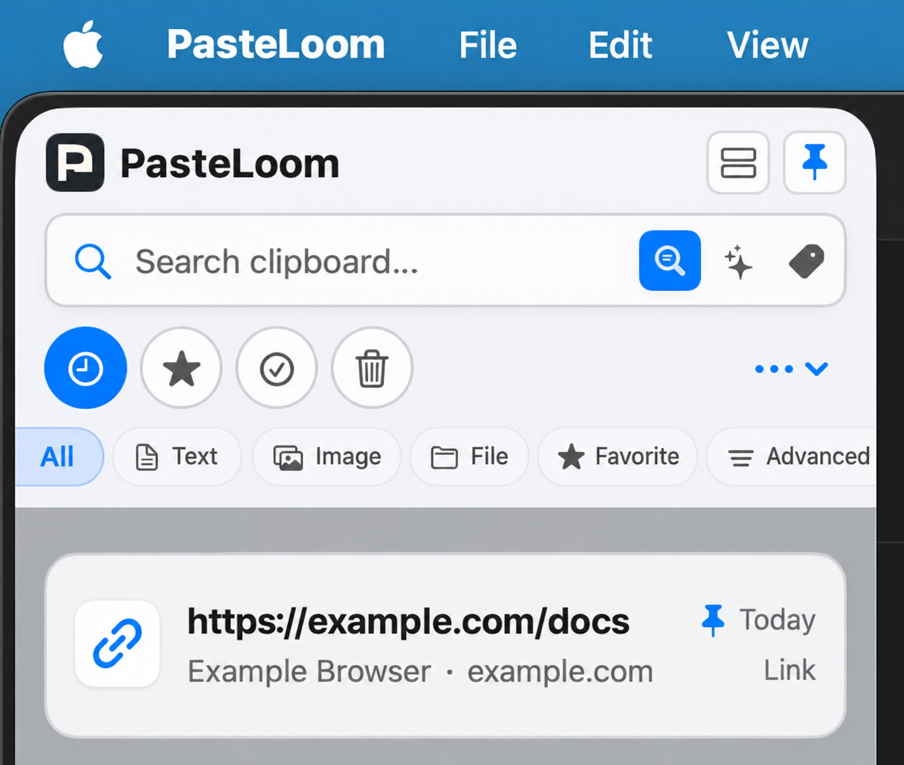

# PasteLoom

**Native macOS clipboard history with local search, Quick Paste, and screenshot annotation.**

## 下载 PasteLoom

**[下载 macOS 通用版 DMG（Apple Silicon 与 Intel）](https://github.com/GYRYEZ/PasteLoom/raw/refs/heads/main/PasteLoom-macOS-Universal.dmg)**

DMG 也可在仓库根目录的 `PasteLoom-macOS-Universal.dmg` 文件中找到。此安装包不包含任何剪贴板历史或个人数据。该版本尚未进行 Developer ID 签名和 Apple 公证，首次打开时 macOS 可能显示安全提示。

SHA-256：`3edbf87096e61aa4e92714a9430bbcf29c7535966e6681e35820d636cb683b78`


## 界面预览

以下图片使用通用示例内容展示 PasteLoom 的主抽屉和菜单栏面板，不包含真实剪贴板历史、账号或本地路径。它们是脱敏展示图，不是当前运行应用的原始截图。

### 主抽屉



### 菜单栏历史面板



---

## 中文完整说明

PasteLoom 是面向 macOS 的本地剪贴板历史工具。它持续观察系统剪贴板，在本机保存可检索的历史记录，并通过主抽屉、菜单栏面板和 Quick Paste 面板提供访问入口。

本文描述当前代码库提供的能力和使用方式，不代表所有高级模块都已完成发布级验收。项目仍在开发中，系统快捷键、权限、截图、多显示器和跨架构发布等行为需要结合具体 Mac 环境验证。

### 功能概览

#### 剪贴板历史

- 支持文本、URL、图片、文件及多文件条目；也包含富文本和视频文件相关处理代码。
- 使用本地 SQLite 保存记录和元数据，图片资源保存在用户 Application Support 目录。
- 支持关键词搜索、内容类型筛选、标签、收藏和置顶。
- 从历史记录复制回系统剪贴板，并尽可能保留原有内容类型。
- 可暂停或恢复捕获。应用内的数据保留和隐私选项请以当前设置页实际显示为准。

#### 访问历史

- **主抽屉**：贴近屏幕边缘显示历史卡片，支持列表和网格布局。
- **菜单栏面板**：从菜单栏图标打开历史记录、搜索和常用入口。
- **Quick Paste**：通过全局快捷键调出面板，以键盘搜索、选择并复制；启用 Auto Paste 时会尝试恢复原应用焦点并发送粘贴操作。

Auto Paste 依赖 Accessibility 权限。没有权限时仍可使用搜索和 Copy Only。快捷键、焦点恢复和每个目标 App 的粘贴响应需要在真实桌面环境中测试。

#### 截图与标注

截图模块包含系统截图捕获流程和标注编辑器。编辑器提供裁剪、矩形、椭圆、箭头、直线、画笔、文字、马赛克、撤销/重做，以及保存 PNG 和复制图片等操作。屏幕捕获需要用户在 macOS 隐私设置中授权屏幕与系统录制；应用不会自动修改 TCC 或绕过权限。

#### 搜索、外观和数据

应用包含全文关键词搜索、语义搜索组件、主题外观、标签与内容筛选、备份导入导出、OCR、规则与脚本、MCP 和同步相关模块。上述模块的可用范围、端到端状态和限制可能不同；请查看[当前状态记录](PASTELOOM_NEXT_CURRENT_STATUS.md)和[功能差距矩阵](PASTELOOM_NEXT_FEATURE_GAP_MATRIX.md)，并以实际构建验证为准。界面中出现某项功能不等于该功能已通过所有验收。

### 快速开始

#### 从源码构建

环境要求：macOS 14 或更高版本，以及包含 macOS SDK 的 Xcode。

```sh
xcodebuild -project PasteLoom/PasteLoom.xcodeproj \
  -scheme PasteLoom \
  -destination 'platform=macOS' \
  build

xcodebuild -project PasteLoom/PasteLoom.xcodeproj \
  -scheme PasteLoom \
  -destination 'platform=macOS' \
  test
```

也可以在 Xcode 中打开 `PasteLoom/PasteLoom.xcodeproj`，选择 `PasteLoom` scheme 后运行。

#### 基本操作

1. 启动 PasteLoom，并在其他 App 中复制文本、链接、图片或文件。
2. 打开 PasteLoom 主抽屉或菜单栏面板，在历史列表中浏览和搜索。
3. 选择条目执行 Copy Back；需要直接粘贴时使用 Quick Paste，并按设置选择 Copy Only 或 Auto Paste。
4. 复制的图片可以从历史详情打开标注器，完成后保存图片或复制到系统剪贴板。
5. 在设置页按需调整捕获、快捷键、外观和权限相关选项。

具体快捷键以设置页显示为准。系统权限由 macOS 的“系统设置 → 隐私与安全性”管理。

### 本地数据与隐私

剪贴板可能包含密码、令牌、个人资料或工作内容。首次使用前，请检查内容捕获、排除应用和敏感内容选项，并避免在共享或演示场景中展示私人历史。

历史数据库和图片资源位于当前用户的 Application Support 目录下的 PasteLoom 数据目录。实际目录名称由当前构建的存储层确定。不要将数据库、图片资源或备份提交到 GitHub，也不要把它们附加到公开 issue。

应用不会绕过 macOS 的隐私权限。可选同步或 AI/MCP 相关功能应在启用前检查其当前状态和数据流；本地存储是默认使用方式。

### 项目结构

| 目录 | 职责 |
|---|---|
| `PasteLoom/App` | 应用入口、运行时和依赖装配 |
| `PasteLoom/Clipboard` | NSPasteboard 读取、分类和图片规范化 |
| `PasteLoom/Domain` | 历史记录领域模型 |
| `PasteLoom/Persistence` | SQLite 仓储、图片资源和保留策略 |
| `PasteLoom/Search` | 本地关键词与语义搜索组件 |
| `PasteLoom/QuickPaste` | 全局快捷键、快速粘贴、焦点恢复与边缘监测 |
| `PasteLoom/Screenshot` | 屏幕捕获、截图浮层和标注编辑器 |
| `PasteLoom/UI` | 主界面、菜单栏历史、设置和数据视图 |
| `PasteLoom/Permissions` / `Privacy` | 系统权限和敏感内容处理 |
| `PasteLoom/Automation` / `MCP` / `Sync` / `Widget` | 高级集成模块；成熟度以当前状态文档为准 |
| `PasteLoomTests` | 单元与集成测试 |

### 质量与限制

- 数据库 schema 会随版本迁移；不要用删除数据库的方式处理升级问题。
- 剪贴板轮询无法恢复两次观察之间已经被系统后续内容覆盖的中间状态。
- 文件历史保存的是文件引用，不保证源文件移动或删除后仍可访问。
- 未签名和未公证的构建可能被 macOS Gatekeeper 提示拦截。
- Intel 兼容性需要检查发布应用二进制确实包含 `x86_64`，并在 Intel Mac 上实测；不能只根据 Swift 源码推断。

### 贡献与问题反馈

提交问题时请提供 macOS 版本、芯片架构、PasteLoom 版本、复现步骤和相关日志。请先移除剪贴板正文、文件路径、截图和个人信息等敏感内容。没有许可证前，项目尚未开放对外代码贡献或再分发授权。

### 许可状态

项目当前没有选定或附带许可证。GitHub 上的公开可见性本身不会授予复制、修改、再发布或商用许可；许可证由项目所有者之后另行确定。

---

## English


**PasteLoom is a native macOS clipboard history app.** It keeps copied content in a local searchable library, with quick access from an edge drawer, a menu bar panel, and a keyboard-driven Quick Paste panel.

> **Development build:** PasteLoom is under active development. Some system-level workflows depend on macOS permissions and need hands-on validation. This source repository is not a signed or notarized release. Keep other copies of important clipboard content.

## What it does

- Captures text, URLs, images, files, multiple files, and supported rich-text or video-file representations from the system pasteboard.
- Stores history and image assets locally using SQLite and the user's Application Support folder.
- Searches history, including local semantic matching, and supports content filters, tags, favorites, and pinned items.
- Copies saved entries back to the system pasteboard. Quick Paste also offers keyboard navigation and optional Auto Paste.
- Provides a menu bar history panel and an edge-attached main drawer with list and grid layouts and appearance themes.
- Captures screenshots and includes an annotation editor with crop, shapes, arrows, lines, pen, text, mosaic, undo/redo, save, and copy actions.
- Includes local OCR, backup/import/export, retention and privacy settings. Advanced integration areas such as automation, MCP, widgets, and sync are experimental and may be incomplete; see [the current project status](PASTELOOM_NEXT_CURRENT_STATUS.md) and [feature matrix](PASTELOOM_NEXT_FEATURE_GAP_MATRIX.md).

Feature presence in the interface does not guarantee that every workflow is production-ready. The project reports document the scope and limits of validation.

## Requirements

- macOS 14 or later
- Xcode with the macOS SDK
- Apple Silicon or Intel Mac for a native build. A universal release artifact is not currently provided by this source checkout.

The app bundle identifier is `com.gyryez.pasteloom`.

## Build and test

```sh
xcodebuild -project PasteLoom/PasteLoom.xcodeproj \
  -scheme PasteLoom \
  -destination 'platform=macOS' \
  build

xcodebuild -project PasteLoom/PasteLoom.xcodeproj \
  -scheme PasteLoom \
  -destination 'platform=macOS' \
  test
```

Or open `PasteLoom/PasteLoom.xcodeproj` in Xcode and run the `PasteLoom` scheme.

## Permissions and privacy

Clipboard history may contain private or sensitive information. History is stored locally by default; review capture exclusions and privacy settings before use. Optional operations such as Auto Paste and screen capture require macOS permissions. PasteLoom does not bypass Accessibility, Screen Recording, or other system privacy controls.

The application stores its database and image assets in the current user's Application Support directory. Do not upload a live user database or personal clipboard history when filing an issue.

## Documentation

- [中文使用说明与项目介绍](PasteLoom_Complete_Guide.md)
- [Current implementation status](PASTELOOM_NEXT_CURRENT_STATUS.md)
- [Feature gap matrix](PASTELOOM_NEXT_FEATURE_GAP_MATRIX.md)
- [Implementation plan](PASTELOOM_NEXT_IMPLEMENTATION_PLAN.md)
- [Product and behavior specifications](PASTELOOM_PRODUCT_SPEC.md), [UI specification](PASTELOOM_UI_SPEC.md), and [settings specification](PASTELOOM_SETTINGS_SPEC.md)

The reports and specifications are development records. Some are historical snapshots and may describe earlier commits; consult the current status document 

for the latest verification scope.

## Release status

This repository is for development and evaluation. No Developer ID signed/notarized release is included. A macOS Gatekeeper warning may appear for locally built or unsigned copies. Intel and Apple Silicon release compatibility must be verified against the specific release artifact, not inferred from the source code alone.

## License

No license has been selected or included yet. Until the project owner adds a license, public visibility of the repository does not grant permission to copy, modify, distribute, or sublicense the code. Please do not treat this project as open-source licensed software.

## Project identity

PasteLoom is developed as a new, independent implementation using public macOS APIs and the product specifications in this repository. It does not include source code copied from the earlier PasteLoom/Clipth project.
